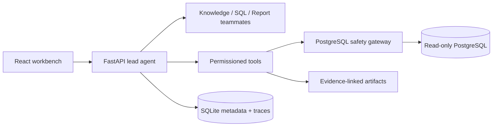

# Governed Data Analysis Agent

An interview portfolio for Agent Engineer roles: a local workbench where a lead agent delegates bounded analysis work, queries governed PostgreSQL sources, produces evidence-linked reports, and leaves a replayable trace.

> Screenshot/GIF slot: add a real recording here after the UI demo is captured.

| Governed PostgreSQL | Bounded agent team | Replayable trace | Reviewed skill candidate |
| --- | --- | --- | --- |
| AST validation, policy checks, EXPLAIN heuristics and one-time approval | Lead may coordinate at most three role-scoped teammates | Redacted event timeline records retry and artifact relationships | Accepted candidates remain disabled by default |



## 30-second demo

1. Start the API and web app below.
2. Create a PostgreSQL source and mark `manager_email` as approval-required.
3. Ask the question in [examples/postgres-business-review/question.md](examples/postgres-business-review/question.md).
4. Inspect the approval, a safe `query_timeout` retry, the three teammate records, report evidence, and the Trace tab.
5. Open the checked-in [golden replay](examples/traces/golden-run.json). It is deterministic and redacted.

The SQL path is: parse/allow-list -> schema and policy evaluation -> bounded `EXPLAIN` heuristic -> one-time approval where required -> read-only execution with timeout/result limits -> evidence artifact and trace.

## Quick start

Requires Python 3.12 and Node 20.

```powershell
py -3.12 -m venv .venv
.\.venv\Scripts\Activate.ps1
python -m pip install -e ".[dev]"
npm --prefix web ci
data-analysis-agent serve --host 127.0.0.1 --port 8765
# in another terminal
npm --prefix web run dev
```

The deterministic tests require no model API key or PostgreSQL. For optional live PostgreSQL checks, set `TEST_POSTGRES_DSN` (or use the synthetic fixture in [examples/postgres-business-review](examples/postgres-business-review)); never commit a DSN.

## Verification

```powershell
python -m pytest tests/test_portfolio_acceptance.py -v
python -m pytest -v
npm --prefix web test -- --run
npm --prefix web run build
python scripts/export_golden_trace.py
```

## Security boundaries and known limits

- Python execution is trusted local execution, not a hostile-code sandbox.
- PostgreSQL access is designed for a read-only account; only PostgreSQL is supported.
- EXPLAIN cost is a heuristic, not a performance guarantee.
- Teammates are bounded to three and have role-specific tool allowlists; they are not autonomous long-running workers.
- Trace coverage currently focuses on lead/tool boundaries. The checked-in golden trace is deterministic; true PostgreSQL integration needs an explicit DSN.
- Skill candidates require review and stay disabled; this is not autonomous self-improvement.

Read [architecture](docs/architecture.md), [SQL safety](docs/sql-safety.md), [multi-agent runtime](docs/multi-agent-runtime.md), [trace and skill](docs/trace-and-skill.md), [security](SECURITY.md), and [contributing](CONTRIBUTING.md) for implementation detail.
